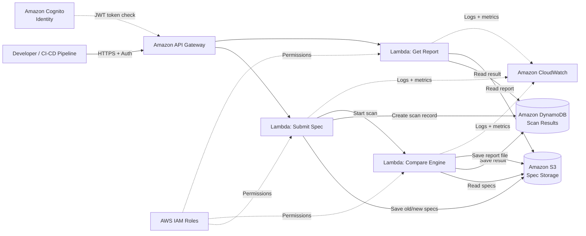

# SWYNEX-Cloud-Architecture-Outline

## API Sentinel: Automated API Compatibility and Breaking-Change Detection System

**Task 1 – Cloud Architecture Outline | SWYNEX Technologies Internship**
**Cloud Provider:** AWS | **Level:** Conceptual design

---

## 1. Overview

Modern applications use APIs to talk to each other. When an API changes (for example, an endpoint is removed or a field is renamed), other applications that depend on it can fail.

**API Sentinel** is a cloud-based system that compares an **old** API specification with a **new** one, finds breaking changes *before* release, and creates a report with:

- the affected endpoints
- a severity level (High / Medium / Low)
- a recommended fix

## 2. Goals

| Goal | Description |
|------|-------------|
| Early detection | Find breaking changes before production |
| Clear reports | Show what broke, how serious it is, and how to fix it |
| Easy to use | Simple REST API that fits into CI/CD pipelines |
| Secure | Private storage and least-privilege access |
| Low cost | Serverless, pay only for what is used |

## 3. High-Level Architecture



## 4. Architecture Layers

### 4.1 Compute

| Service | Purpose |
|---------|---------|
| **AWS Lambda – Submit Function** | Receives the old and new API specs, validates them, stores them, creates a scan record |
| **AWS Lambda – Compare Function** | Reads both specs, finds differences, labels severity, builds the report |
| **AWS Lambda – Report Function** | Returns scan status and report to the user |

*Why Lambda?* No servers to manage, scales automatically, and costs nothing when idle.

### 4.2 Storage

| Service | What it stores |
|---------|----------------|
| **Amazon S3** | API spec files (OpenAPI/Swagger JSON or YAML) and generated report files |
| **Amazon DynamoDB** | Scan metadata: scan ID, status, time, summary of issues, link to the report |

**S3 bucket layout**

```
api-sentinel-bucket/
├── specs/
│   └── {apiName}/{scanId}/old.json
│   └── {apiName}/{scanId}/new.json
└── reports/
    └── {scanId}/report.json
```

**DynamoDB table: `ScanResults`**

| Attribute | Type | Note |
|-----------|------|------|
| `scanId` | String | Partition key |
| `apiName` | String | Name of the API being checked |
| `status` | String | PENDING / RUNNING / COMPLETED / FAILED |
| `createdAt` | String | ISO timestamp |
| `totalIssues` | Number | Count of breaking changes |
| `highCount`, `mediumCount`, `lowCount` | Number | Count per severity |
| `reportKey` | String | S3 path of the full report |

A Global Secondary Index on `apiName` + `createdAt` lets users see scan history per API.

### 4.3 Networking

| Component | Role |
|-----------|------|
| **Amazon API Gateway (REST)** | Public HTTPS entry point; handles routing, throttling, and request validation |
| **HTTPS / TLS** | All traffic is encrypted in transit |
| **Amazon S3 + DynamoDB VPC Gateway Endpoints** *(optional)* | Keep traffic to storage on the private AWS network if Lambda runs inside a VPC |
| **AWS WAF** *(optional)* | Blocks common web attacks on API Gateway |

Lambda functions can run outside a VPC for this simple design. This keeps cost and complexity low.

### 4.4 Identity and Access

| Service | Role |
|---------|------|
| **Amazon Cognito** *(or API keys for a simple version)* | Signs users in and issues tokens for API Gateway |
| **AWS IAM** | Gives each Lambda its own role with only the permissions it needs |

**Least-privilege example**

| Lambda | Allowed actions |
|--------|-----------------|
| Submit | `s3:PutObject` on `specs/*`, `dynamodb:PutItem`, `lambda:InvokeFunction` (Compare only) |
| Compare | `s3:GetObject` on `specs/*`, `s3:PutObject` on `reports/*`, `dynamodb:UpdateItem` |
| Report | `s3:GetObject` on `reports/*`, `dynamodb:GetItem`, `dynamodb:Query` |

### 4.5 Monitoring and Logging

| Service | Use |
|---------|-----|
| **Amazon CloudWatch Logs** | Stores Lambda and API Gateway logs |
| **CloudWatch Metrics** | Tracks request count, errors, latency, scan duration |
| **CloudWatch Alarms** | Alerts when error rate is high |
| **AWS CloudTrail** *(optional)* | Records who did what in the AWS account |

## 5. Request Flow (Step by Step)

1. The developer (or CI/CD pipeline) calls `POST /scans` with the old and new API specs.
2. API Gateway checks the user token and request format.
3. The **Submit Lambda** saves both files in S3 and creates a `PENDING` record in DynamoDB.
4. The **Compare Lambda** is started. It reads both specs from S3.
5. It checks for breaking changes (see section 6).
6. It saves the report in S3 and updates DynamoDB to `COMPLETED`.
7. The developer calls `GET /scans/{scanId}` to see the status and summary.
8. The developer calls `GET /scans/{scanId}/report` to get the full report.

## 6. Breaking-Change Rules

| Change type | Example | Severity | Recommended action |
|-------------|---------|----------|--------------------|
| Endpoint removed | `DELETE /users/{id}` no longer exists | **High** | Keep the endpoint, or mark as deprecated first |
| HTTP method changed | `GET /orders` becomes `POST /orders` | **High** | Keep the old method for a transition period |
| Response field removed or renamed | `userName` renamed to `username` | **High** | Return both fields for a while |
| Data type changed | `age`: string → integer | **High** | Add a new field, keep the old type |
| New required parameter | New required query param `region` | **High** | Make it optional with a default value |
| Optional parameter made required | `limit` is now required | **Medium** | Keep it optional |
| Enum value removed | Status `"pending"` removed | **Medium** | Keep old values or version the API |
| Response code changed | `200` changed to `201` | **Medium** | Document it and notify clients |
| New optional field or endpoint added | New `nickname` field | **Low** (safe) | No action needed |
| Description or example text changed | Docs only | **Info** | No action needed |

## 7. Sample API

| Method | Path | Description |
|--------|------|-------------|
| `POST` | `/scans` | Submit old and new specs, start a scan |
| `GET` | `/scans/{scanId}` | Get scan status and summary |
| `GET` | `/scans/{scanId}/report` | Get the full report |
| `GET` | `/apis/{apiName}/scans` | List past scans for an API |

**Sample report**

```json
{
  "scanId": "a1b2c3",
  "apiName": "orders-service",
  "status": "COMPLETED",
  "summary": { "high": 2, "medium": 1, "low": 0 },
  "issues": [
    {
      "endpoint": "GET /orders/{id}",
      "change": "Response field 'total' removed",
      "severity": "HIGH",
      "recommendation": "Keep the 'total' field or release a new API version."
    },
    {
      "endpoint": "POST /orders",
      "change": "New required parameter 'currency'",
      "severity": "HIGH",
      "recommendation": "Make 'currency' optional with a default value."
    }
  ]
}
```

## 8. Security Design

- **Encryption in transit:** HTTPS only.
- **Encryption at rest:** S3 (SSE-S3 or KMS) and DynamoDB encryption turned on.
- **Private storage:** S3 "Block Public Access" enabled.
- **Least privilege:** each Lambda has its own IAM role.
- **Input validation:** API Gateway checks request size and format; the Submit Lambda checks that files are valid OpenAPI.
- **Throttling:** rate limits on API Gateway to prevent abuse.
- **Audit:** CloudWatch Logs and CloudTrail.

## 9. Scalability and Reliability

- Lambda and API Gateway scale automatically with demand.
- DynamoDB uses on-demand capacity, so there is no capacity planning.
- S3 is highly durable (11 nines) and spread across multiple Availability Zones.
- Failed scans are marked `FAILED` and can be retried (optional SQS Dead Letter Queue).

## 10. Cost Overview

| Service | Cost style |
|---------|------------|
| API Gateway | Per request |
| Lambda | Per run time and memory |
| S3 | Per GB stored |
| DynamoDB | Per read/write (on-demand) |
| CloudWatch | Per GB of logs |

Because everything is serverless, the cost for a small project or demo is very low and can fit in the AWS Free Tier.

## 11. CI/CD Integration (Use Case)

A pipeline step (GitHub Actions, Jenkins, etc.) can call API Sentinel on every pull request:

1. Send the current production spec and the new spec.
2. Wait for the report.
3. **Fail the build** if any **High** severity issue is found.

## 12. Future Improvements

- Support GraphQL and gRPC schemas.
- Send results to Slack, email, or GitHub pull request comments (Amazon SNS).
- Add a web dashboard (S3 + CloudFront).
- Use Step Functions for larger, multi-step scans.
- Use Amazon Bedrock to write easier-to-read fix suggestions.

## 13. Conclusion

API Sentinel uses simple AWS serverless services to catch breaking API changes early. API Gateway receives requests, Lambda does the work, S3 and DynamoDB store data, IAM controls access, and CloudWatch watches the system. This design is low cost, secure, and easy to grow.

---

**Keywords:** API Compatibility, Breaking-Change Detection, AWS Cloud Architecture, REST APIs, Automated Testing, Software Reliability

*Completed as Task 1 of the internship with SWYNEX Technologies. #SWYNEX #Internship*
